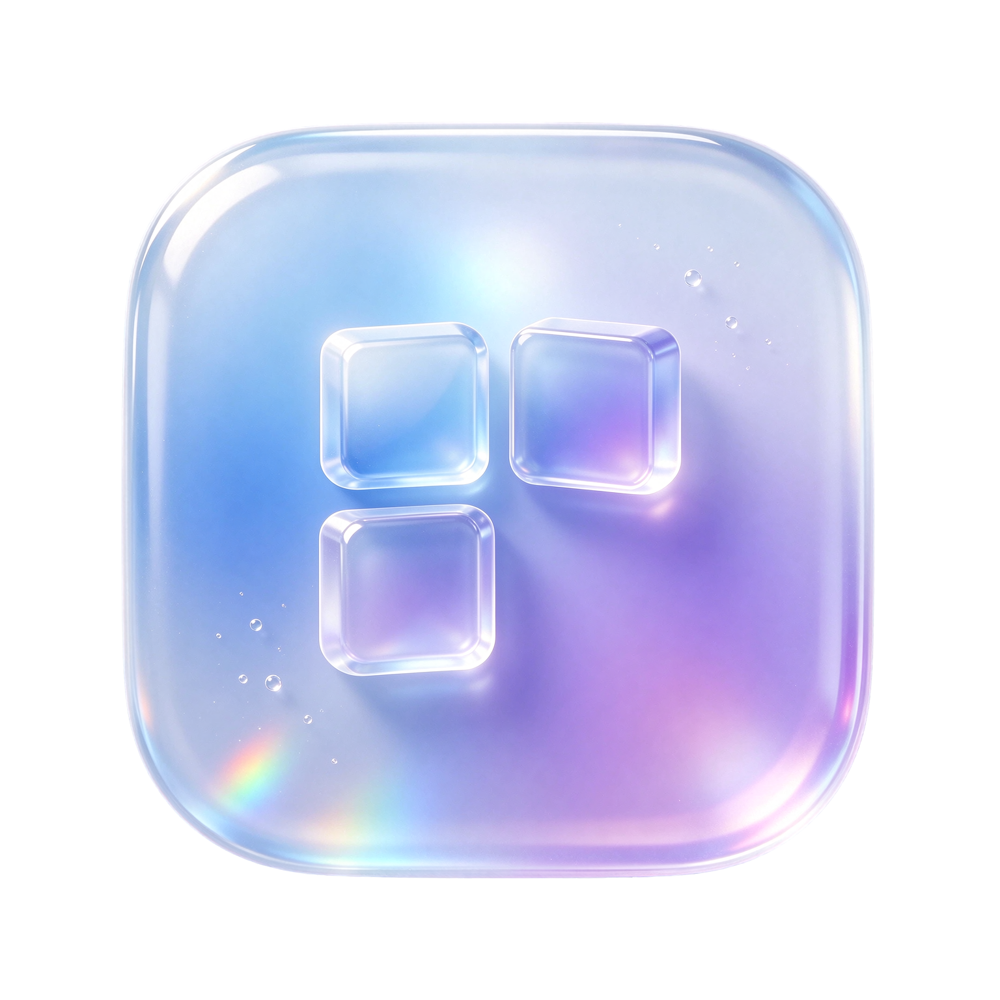
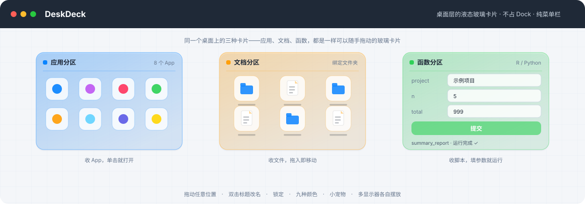
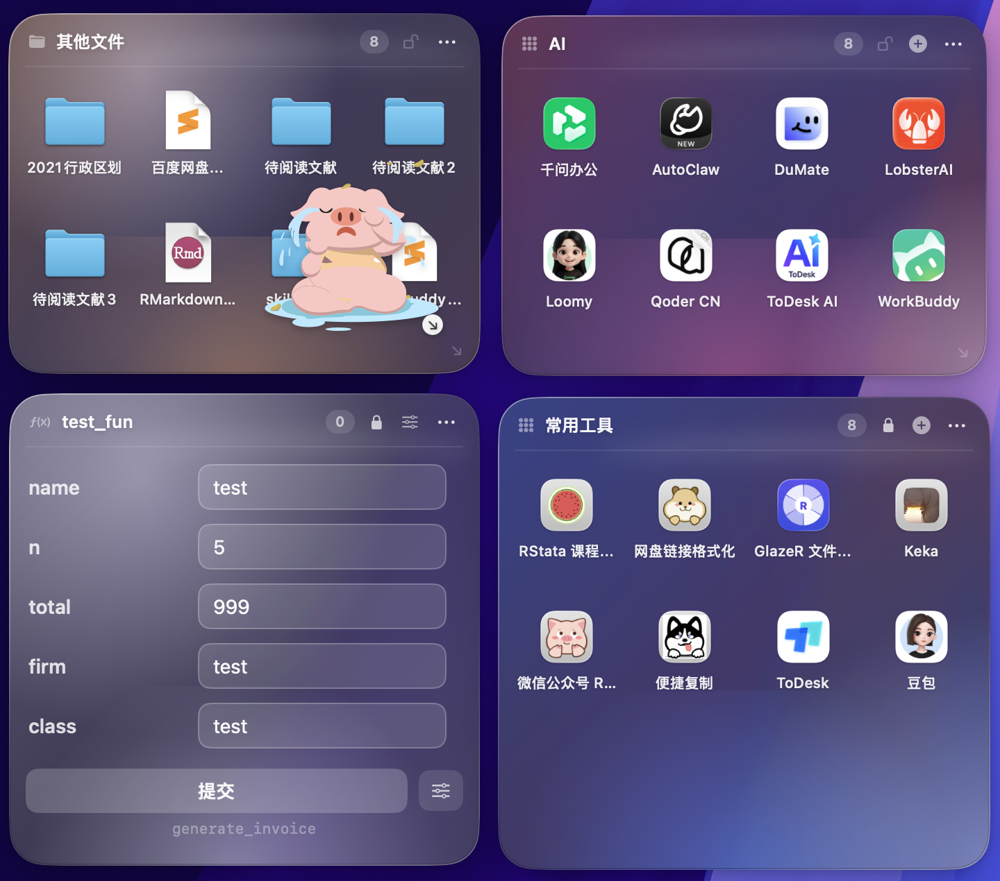
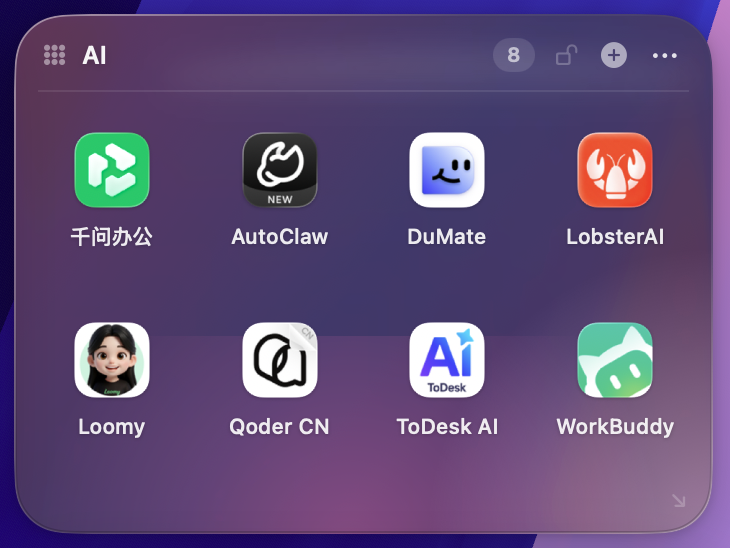
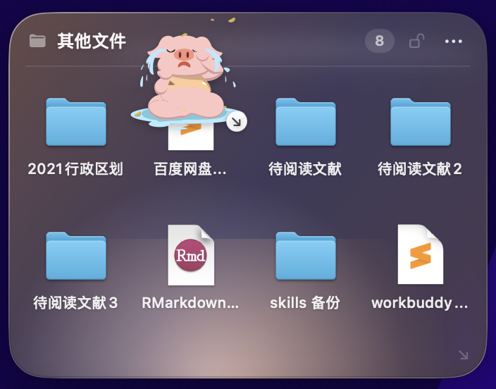
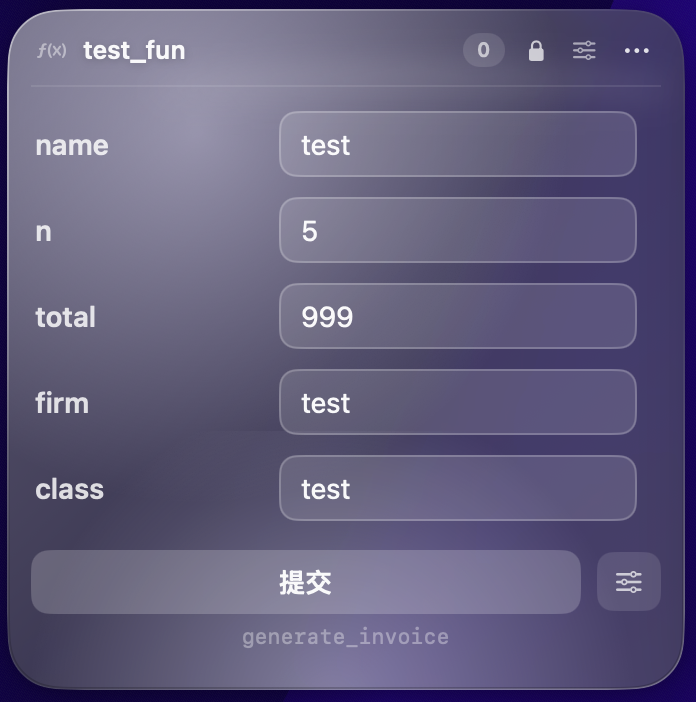
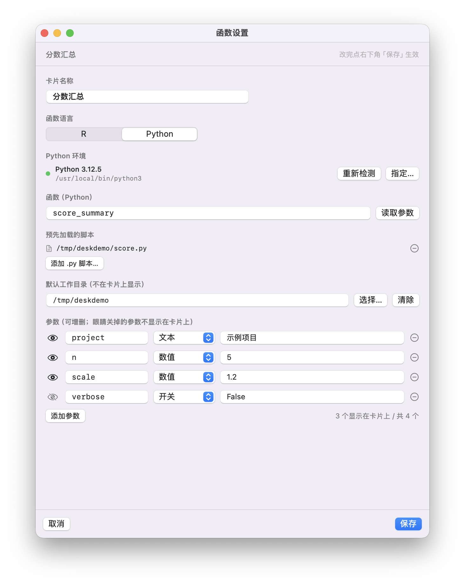
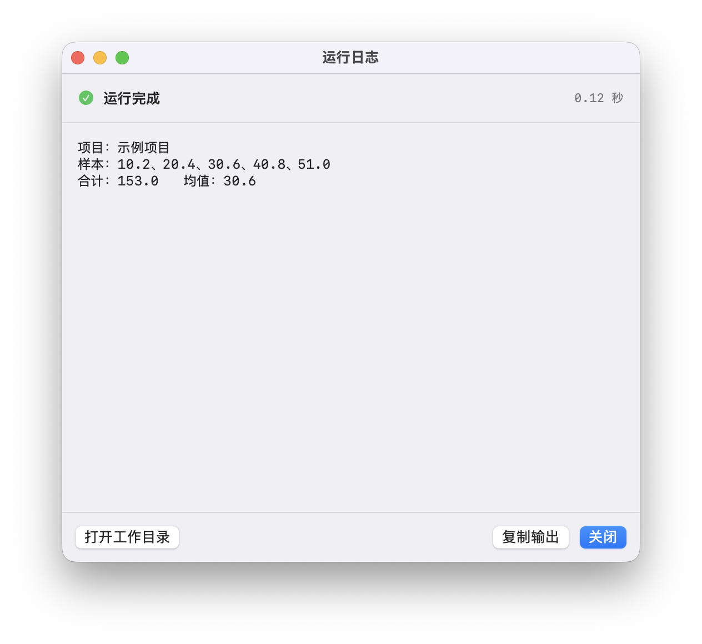
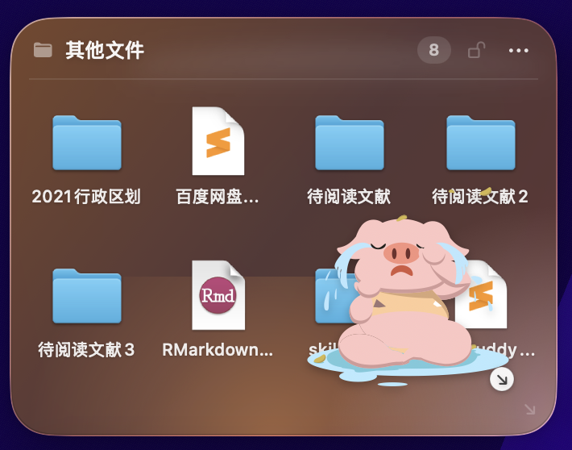
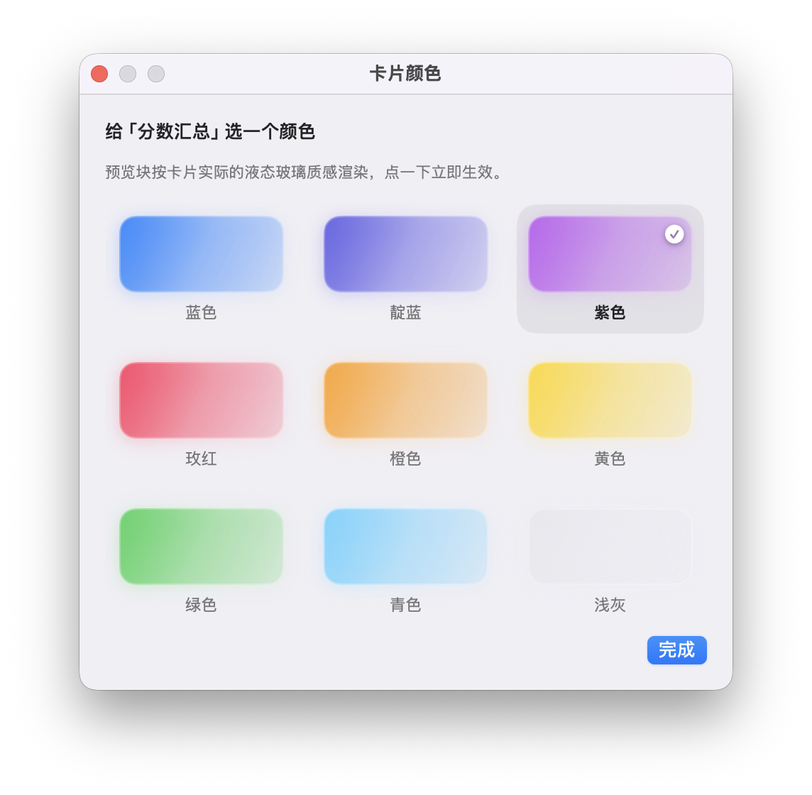

<div align="center">
<p align="center">
  
</p>
  <h1>DeskDeck — a desktop manager for Mac</h1>
  <p><strong>Turn your desktop into a deck of glass cards you can shuffle around</strong></p>
  <p>Apps / Documents / Functions partitions · liquid-glass look · fill in the params, hit Submit, run R and Python right there</p>
  <p><em>Desk + Deck: the deck of cards on your desk. Native SwiftUI + AppKit, macOS 14+, lives in the menu bar.</em></p>
  <p><a href="README.md">简体中文</a> · <strong>English</strong></p>
</div>

<p align="center">
  
  
  
  
  
</p>

<p align="center">
  <picture>
    <source media="(prefers-color-scheme: dark)" srcset="assets/hero-dark.svg">
    
  </picture>
</p>

DeskDeck is a desktop partition tool for macOS. It puts a few “liquid glass” cards on the desktop layer: collect your apps into an apps partition, files and folders into a documents partition, and turn a treasured R / Python script into a function card — fill in the parameters, hit **Submit**, and it runs. Cards can be moved freely, dragged, resized, locked and recoloured, and each card can host a little mascot.

<p align="center">
  
</p>

- Native SwiftUI + AppKit, macOS 14+. On macOS 26 it uses the system Liquid Glass (`glassEffect`); on older systems it approximates it with wallpaper blur plus hand-drawn highlights
- Menu-bar-only app (`LSUIElement`): no Dock icon, no floating button parked in the top-right corner
- Multi-display: one overlay window per screen; every card remembers which screen it lives on
- **The mouse is captured only while the pointer is over a card.** Everywhere else the whole overlay window is transparent to the mouse, so desktop icons, context menus and Finder drag-and-drop keep their native feel

## Where the name comes from

**DeskDeck = Desk + Deck** (a deck of cards).

The project started out as “桌面管理大师” (Desktop Management Master) and was later renamed DeskDeck, because what it wants to express is simpler:

- **Desk**: it does not open a separate window and it is not a launcher. It works on the desktop you already have — cards and desktop icons live on the same layer.
- **Deck**: a partition is not a folder, it is **a deck of cards**. Each card can be dragged, locked, recoloured and given its own mascot. Like holding a deck of playing cards: use whichever card you need.
- The “deck” of a ship is in there too: the desktop is your workbench, the cards are the tools lying on it — they stay out of your sightline and never steal focus.

## The three partition types

### Apps partition

Collect frequently used apps into one card. Icons are taken from the apps themselves; a single click launches.

<p align="center">
  
</p>

- Drag a `.app` in from Finder, or pick one from the `＋` panel in the title bar
- Single click opens the app; right-click offers “Reveal in Finder” and “Remove from partition”
- When the card is unlocked a click opens the app; when locked, the lock only prevents accidental dragging of the card — icons still work

### Documents partition

Binds to a real folder; the card is a mirror of that folder.

<p align="center">
  
</p>

- **Drag in** = the file is moved into the bound folder, and the card refreshes live (`DispatchSource` watches the directory)
- **Drag out** = the file leaves the bound folder; drop it on the desktop or into any Finder window. **This works while the card is locked** — locking only freezes card movement and resizing
- **Single click selects, double click opens.** A single click only highlights the item (white outline); a double click actually opens it. With an item selected, `⌘C` copies **the file itself** (paste into Finder with `⌘V` and you get a real copy). The context menu also has “Copy full path”, which copies just the path text
- Name clashes get numbered automatically; nothing is overwritten

### Functions partition (R / Python)

Turn an analysis script into a card: the card itself only shows parameter fields and a **Submit** button — everything else is configured in the settings window.

<p align="center">
  
</p>

- **Signature reflection**: type the function name in settings and hit “Read parameters”. R uses `formals()`, Python uses `inspect.signature`; parameter names, defaults and types are read in one go and turned into a parameter table
- **Parameters stay editable**: name, type (text / number / switch / dropdown / R expression) and default value can all be edited, and parameters can be added or removed
- **Rarely used parameters can be hidden**: the eye icon on each row controls whether that parameter appears on the card. Hidden parameters take no card space but are still passed at call time with their configured value
- **Submit runs it**: results no longer interrupt you with a dialog — a **green check / red cross** appears in the card's title bar. Click that icon to open the run log

<p align="center">
  
</p>

The settings window covers card name, language (R / Python), interpreter detection or manual path, function name, scripts to source up front, default working directory and the parameter table (including the hide switches). The detected `Rscript` / `python3` path and version are shown at the top.

<p align="center">
  
</p>

Python and R share the same card and parameter table; only the settings differ:

- `int / float` annotations become numbers, `bool` becomes a switch, `typing.Literal[...]` becomes a dropdown
- “Scripts to load first” are `exec`ed into the same namespace and support `function_name` or `module.function_name`
- At run time: `os.chdir(working directory) → exec scripts → call → print the result`

<p align="center">
  
</p>

The run log window reports status, elapsed time and standard output, and offers “Open working directory”, “Copy output” and “Close”. Each R run also writes its return value to an `RDS` file in a temp directory so you can carry on elsewhere.

## Mascot

Any card can host a sticker pet: `⋯` menu in the title bar → **Add mascot…**. Supports **SVG / PNG / GIF / JPG / HEIC** (SVG is rendered by the system with transparency preserved; when the system cannot decode a file the app rasterises it once with QuickLook and caches the PNG; GIFs animate).

<p align="center">
  
</p>

- **Drag**: with “Pin position” off, hold the mascot and move it anywhere inside the card; the position is remembered. Dragging the mascot does not drag the card
- **Resize**: hover over the mascot and scroll (mouse wheel or trackpad) to scale continuously; the menu also offers 32 / 48 / 64 / 96 / 140 pt presets
- **Pin**: with “Pin mascot position” on, the mascot **swallows no mouse events at all** — pressing on it is pressing the card, so card dragging, icon clicks and file drag-out are unaffected
- **Follows the card**: the mascot is drawn inside the card and moves with it; “Move mascot back to the corner” snaps it back

## Card colours

Nine colours. Every swatch is a preview rendered with the card's real liquid-glass material, and a click applies it instantly.

<p align="center">
  
</p>

Blue `#0A84FF` · Indigo `#5E5CE6` · Purple `#BF5AF2` · Pink `#FF375F` · Orange `#FF9F0A` · Yellow `#FFD60A` · Green `#30D158` · Cyan `#64D2FF` · Light grey `#E8E8ED`

## Interaction cheat sheet

| What you want | How to do it |
| --- | --- |
| Create a partition | Menu-bar icon → “New apps partition / New documents partition… / New R function partition / New Python function partition”. The card appears in the middle of the screen |
| Move a card | Hold anywhere on the card and drag (pressing on an icon in a documents partition drags the file out; double-clicking the title bar renames) |
| Resize | Drag the little arrow in the bottom-right corner (hidden when locked) |
| Lock | The lock icon on the right of the title bar, or the `⋯` menu. Locked cards still accept icon clicks and file drag-out |
| Rename | **Double-click the title**: the editor selects the whole name so you can type over it; `Esc` cancels. Function cards can also be renamed via “Card name” in settings |
| Recolour / reorder / change folder / delete / mascot | `⋯` menu in the title bar, or the context menu |
| Temporarily hide all partitions | Menu bar → untick “Show all partitions” |
| Launch at login | Menu bar → “Launch at login” (`SMAppService`) |

Editing shortcuts work inside text fields as usual. The app has no main-menu window, so it installs a hidden App / Edit / Window menu set to forward keystrokes:

| Shortcut | Effect |
| --- | --- |
| `⌘A` / `⌘C` / `⌘V` / `⌘X` | Select all / copy / paste / cut inside text fields |
| `⌘Z` / `⇧⌘Z` | Undo / redo |
| `⌘C` (when no text field is focused) | Copies the selected file or folder itself — `⌘V` in Finder makes a real copy |
| `⌘M` / `⌘W` | Minimise / close the current settings or log window |
| `⌥⌘H` | Hide other apps |

## Data and state

All partitions, colours, lock states, mascots and function configs live in a single JSON file:

```
~/Library/Application Support/DeskDeck/state.json
```

Delete that file and you are back to the initial demo cards. Copy it when you move to a new Mac and your layout, mascot positions and function configurations come along.

## Build and run

```bash
git clone <this-repo> DeskDeck
cd DeskDeck
./build.sh                 # compile + bundle + ad-hoc sign
open DeskDeck.app
```

The output is `DeskDeck.app` (bundle id `com.ac.deskdeck`). Drag it into `/Applications` and launch it from there — launch-at-login depends on that location. Only one instance is allowed: launching again activates the running copy and exits (two stacked desktop overlay windows would block each other's dragging and dropping).

Package installers (a universal build plus separate Apple Silicon / Intel DMGs, each with the usual “drag into Applications” shortcut):

```bash
./package_dmg.sh              # builds universal / arm64 / x86_64 into dist/
./package_dmg.sh universal    # universal only
```

| File | Machines | Size |
| --- | --- | --- |
| `DeskDeck-1.0-universal.dmg` | Apple Silicon and Intel (one fat binary) | 3 MB |
| `DeskDeck-1.0-arm64.dmg` | Apple Silicon | 2.3 MB |
| `DeskDeck-1.0-x86_64.dmg` | Intel Macs (also runs under Rosetta on Apple Silicon) | 2.4 MB |

The installers are ad-hoc signed. If macOS says the developer cannot be verified on first launch, right-click → “Open”, or run `xattr -dr com.apple.quarantine /Applications/DeskDeck.app`. For a double-click-to-install distribution you need your own Developer ID certificate and notarisation.

Requirements: macOS 14+, a Swift 5 toolchain (`swift build`). The R / Python function partitions need `Rscript` and `python3` on the machine. When launched from Finder, `PATH` usually has no Homebrew entries, so the app assembles the common paths itself and also fills in `RSTUDIO_PANDOC`.

## Implementation notes

<details>
<summary>Code structure (about 4,700 lines of Swift)</summary>

- `AppState.swift` — `Partition` (`kind: .apps / .folder / .function`, `locked`, `folderPath`, `rConfig`, `mascot`) plus JSON persistence; documents partitions watch their directory with `DispatchSource`; drag-in uses `moveItem` and handles name clashes
- `DesktopOverlay.swift` — desktop-level borderless window (`desktopIconWindow + 1`, on every Space); a 60 Hz pointer poll flips `ignoresMouseEvents` to get “cards capture, empty area passes through”; dragging is handled by window-level `NSEvent` local monitors and starts after 2 pt; file drop-in goes through `NSDraggingDestination` and drag-out through `NSDraggingSession`; the same window layer also recognises title double-clicks, mascot dragging/scaling and `⌘C` file copy
- `Glass.swift` — wallpaper blur base + `glassEffect` + tint + a pointer-following liquid highlight + refracting outline
- `PartitionCard.swift` — the card view (`.frame` + `.offset` positioning so dragging never triggers layout), resize handle, lock, drop target, icon grid and `ItemTileView` (single click selects, double click opens)
- `FunctionCard.swift` / `FunctionWindows.swift` — parameter form, run-state icon, settings window and run-log window. Attaching a `sheet` to a borderless desktop-level window misbehaves, so both are standalone `NSWindow`s
- `RFunctions.swift` / `PyFunctions.swift` — signature reflection and runners for the two languages; `setwd/chdir → source/exec → do.call/fn(**args) → print`, with `DESKDECK_OUTPUT_BEGIN/END` markers cutting the result out of mixed output
- `Mascot.swift` — `MascotSpec`, SVG read straight into `NSImage` (falling back to a QuickLook rasterisation when the system cannot decode it), GIF frame splitting + `TimelineView` playback, scroll-to-scale with clamping
- `Clipboard.swift` — writes a file URL (plus a text path) so `⌘C` copies the file itself while text fields still get the path
- `GlassTextField.swift` / `TintSwatch.swift` / `ColorPicker.swift` / `AppMenus.swift` — text field with a hand-drawn caret, the nine-colour palette and picker panel, and the hidden menus that forward editing shortcuts
- `assets/hero.svg` + `assets/hero-dark.svg` — README header art (hand-written SVG, switching with GitHub's colour scheme); `docs/screenshots/*.png` are real screenshots of the running app

</details>

## Known limitations

- Cards live on the desktop layer, so they are invisible and unclickable while a normal app window covers them (the same behaviour as Finder desktop icons)
- Apps partitions store paths; if an app moves, the icon turns grey instead of following it
- Documents partitions have no “remove from partition” button: the files really do live in the bound folder, so tidy them in Finder
- Function partitions currently echo text output only; R graphics devices and matplotlib images are not embedded yet
- The first time the app reads your Documents / Desktop / Downloads folders, macOS shows its file-access prompt once

## Credits

- Visual inspiration: macOS 26 Liquid Glass and desktop widgets
- Built by the WeChat account **RStata**

MIT License
