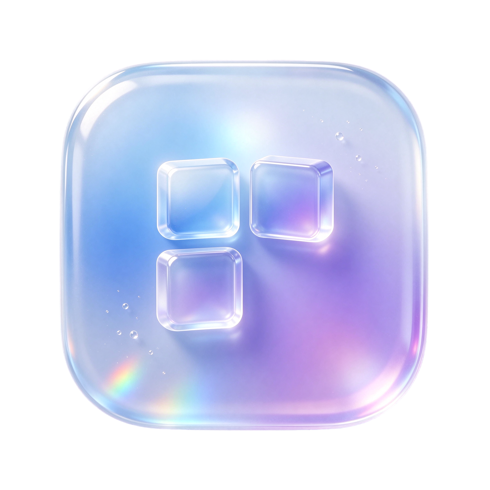
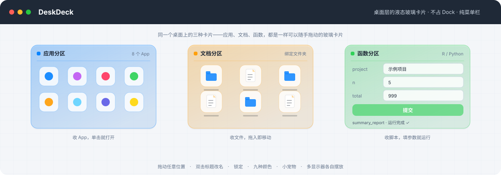
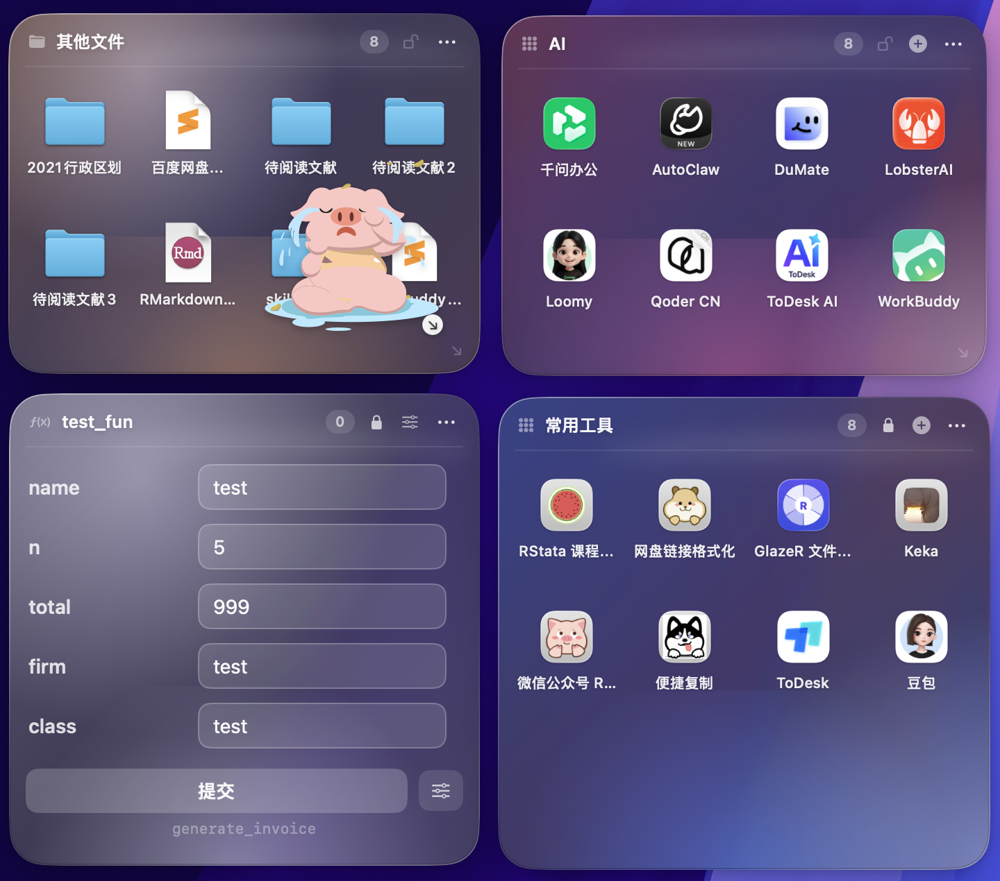
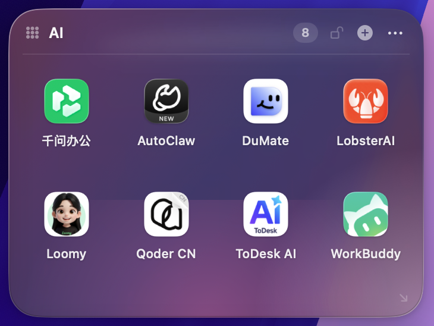
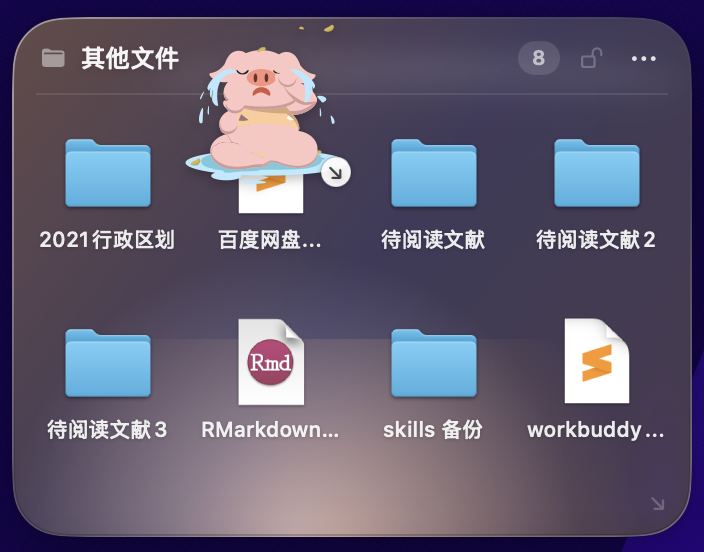
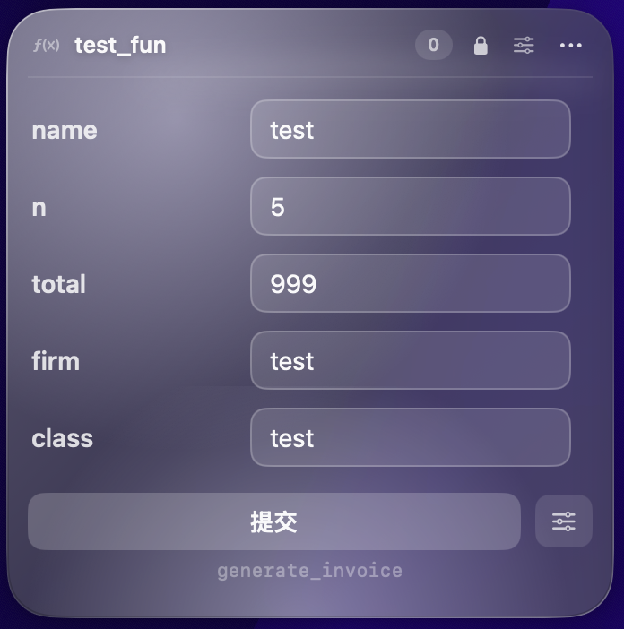
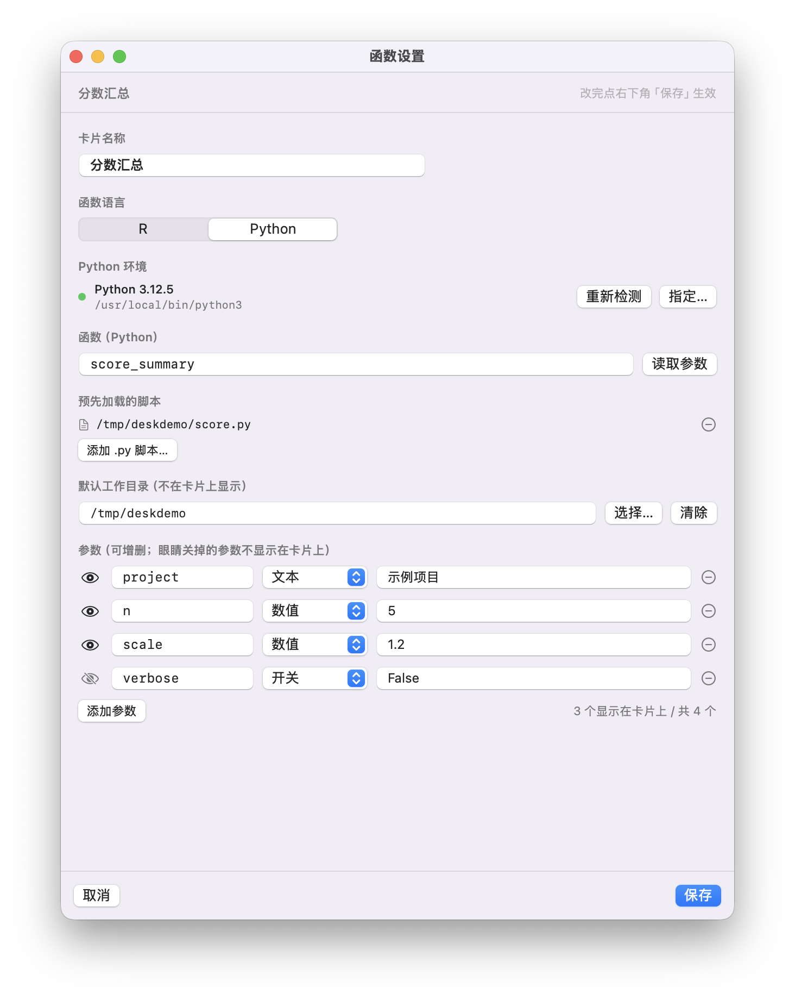
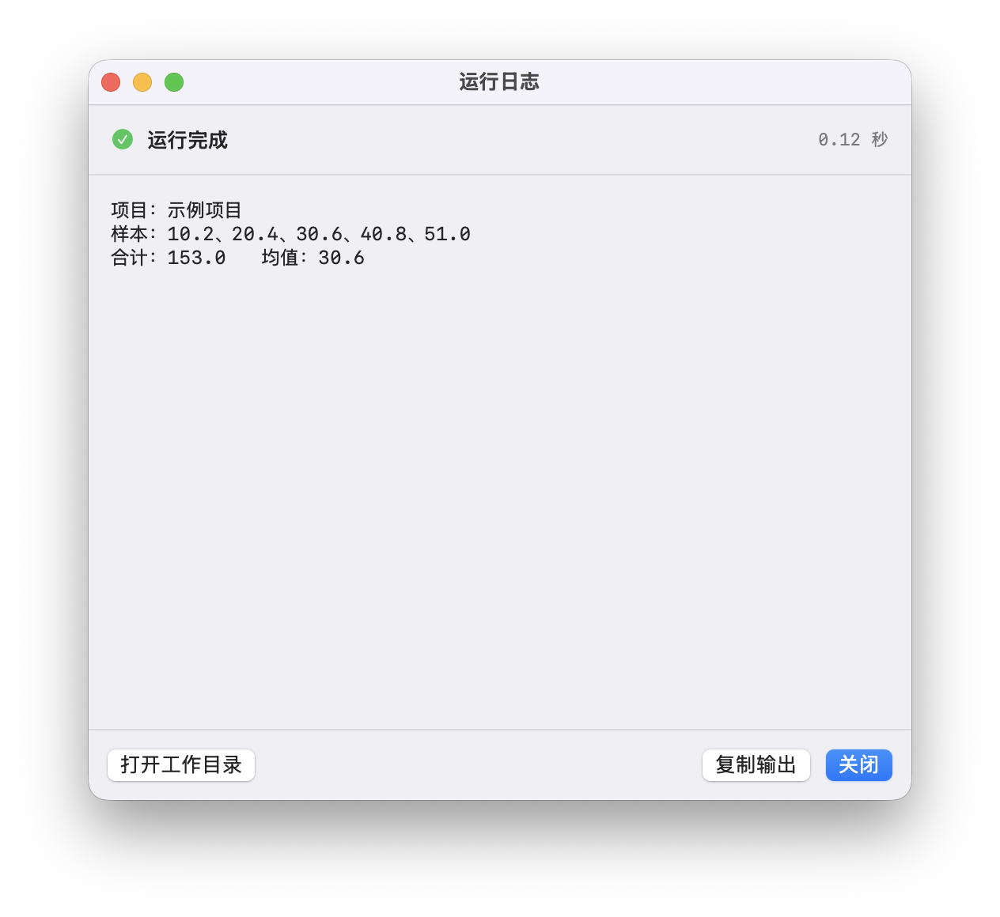
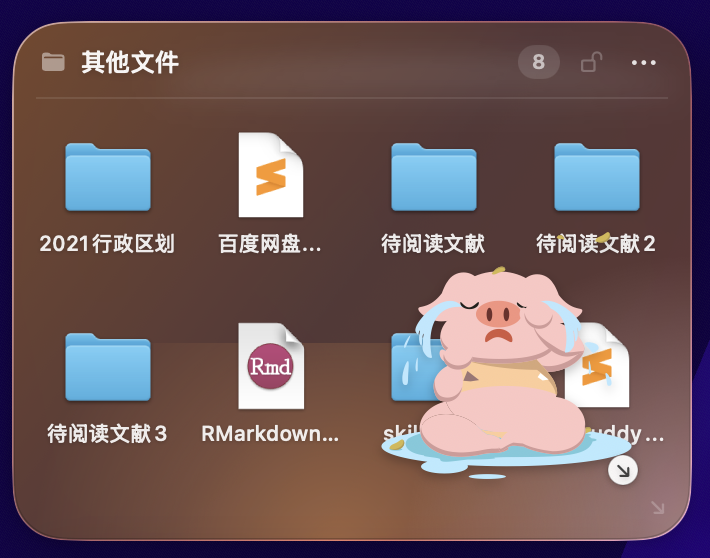
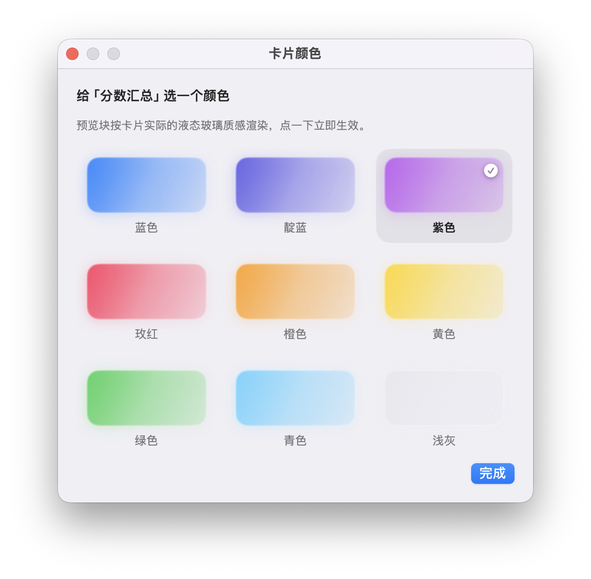

<div align="center">
  
  <h1>DeskDeck：Mac 的桌面管理大师～</h1>
  <p><strong>把桌面变成一叠可以随手翻动的玻璃卡片</strong></p>
  <p>应用 / 文档 / 函数三类分区 · 液态玻璃质感 · 参数填好点「提交」，就地跑 R 与 Python</p>
  <p><em>Desk + Deck：桌面上的那叠卡片。Native SwiftUI + AppKit, macOS 14+, lives in the menu bar.</em></p>
  <p><strong>简体中文</strong> · <a href="README.en.md">English</a></p>
</div>

<p align="center">
  
  
  
  
  
</p>

<p align="center">
  <picture>
    <source media="(prefers-color-scheme: dark)" srcset="assets/hero-dark.svg">
    
  </picture>
</p>

DeskDeck 是一个 macOS 桌面分区工具：在桌面层放几张「液态玻璃」卡片，把 App 收进应用分区、把文件收进文档分区、把常用的 R / Python 脚本做成一张函数卡片，参数填好点「提交」直接跑。卡片可以任意摆放、拖动、缩放、锁定、换色，还可以在卡片上养一只小宠物。



- 原生 SwiftUI + AppKit，macOS 14+；macOS 26 上使用系统原生 Liquid Glass（`glassEffect`），旧系统用壁纸模糊 + 自绘高光近似
- 纯菜单栏应用（`LSUIElement`），不占 Dock，桌面右上角没有任何常驻悬浮按钮
- 多显示器：每块屏幕一个覆盖层窗口，卡片记住自己所在的屏幕
- **只在指针落到卡片范围时才接管鼠标**，其余区域整层窗口对鼠标透明——桌面图标、右键菜单、访达拖拽全部保持原生手感

## 名字从哪来

**DeskDeck = Desk（桌面）+ Deck（一副牌、一叠卡片）。**

这个项目最初叫「桌面管理大师」，后来改成了 DeskDeck，因为想表达的东西更简单：

- **Desk**：它不新建一个独立窗口、不做一套「启动器」，它就在你本来就有的桌面上工作，卡片和桌面图标是同一层的东西；
- **Deck**：分区不是「文件夹」，而是**一叠卡片**——每一张可以单独拖动、单独锁定、单独换色、单独养宠物，像手里的一副牌，想用哪张就翻哪张；
- Deck 也带一点「甲板」的意味：桌面就是你的工作台，卡片是摆在上面的工具，不挡视线、不抢焦点。

## 三种分区

### 应用分区

把常用 App 收进一张卡片，图标来自 App 自己的 icon，单击即启动。



- 从访达把 `.app` 拖进卡片，或点标题栏的 `＋` 面板挑选
- 单击图标直接打开；右键可「在访达中显示」「从分区移除」
- 卡片没锁定时单击图标会打开；锁定时只是防止误拖卡片，图标照常可点

### 文档分区

绑定一个真实文件夹，卡片就是那个文件夹的「镜像」。



- **拖进来** = 文件被移动到绑定文件夹，卡片随文件夹内容实时刷新（`DispatchSource` 监听）
- **拖出去** = 从绑定文件夹移走，直接拖到桌面或任意访达窗口即可；**卡片锁定的时候也能拖出去**，锁定只锁卡片的移动和缩放
- **单击选中、双击打开**：单击只高亮（白色描边），双击才真的打开；选中后按 `⌘C` 复制的是**文件本身**（直接到访达 `⌘V` 就能复制一份），右键菜单里另有「复制完整路径」只取路径文本
- 文件重名时自动加序号，不会覆盖原文件

### 函数分区（R / Python）

把一段分析脚本做成卡片：卡片上只留参数输入框和「提交」，剩下的配置都在设置窗口里。



- **签名反射**：设置里填函数名 → 点「读取参数」，R 用 `formals()`、Python 用 `inspect.signature` 把参数名、默认值、类型一次读出来，自动生成参数表
- **参数可以手工改**：参数名、类型（文本 / 数值 / 开关 / 下拉 / R 表达式）、默认值都能编辑，也能自己加参数、删参数
- **不常用的参数可以隐藏**：每行左边的眼睛图标控制这个参数是否出现在卡片上；隐藏的参数不占卡片位置，但调用时照样按设置里的值传进去
- **提交即运行**：运行结果不再是弹窗打断你，卡片标题栏直接出现 **绿色对勾 / 红色叉号**；点这个图标才打开「运行日志」


设置窗口里能改：卡片名称、语言（R / Python）、环境探测与手动指定解释器、函数名、预先 source 的脚本、默认工作目录、参数表（含隐藏开关）。顶部会显示检测到的 `Rscript` / `python3` 路径与版本。



Python 与 R 共用同一套卡片和参数表，只是设置里切到 Python：

- `int / float` 标注 → 数值，`bool` 标注 → 开关，`typing.Literal[...]` → 下拉选项
- 「预先加载的脚本」会 `exec` 进同一个命名空间，支持 `函数名` 或 `模块名.函数名`
- 运行时 `os.chdir(工作目录) → exec 脚本 → 调用 → print 结果`



「运行日志」窗口给出状态、耗时、标准输出，并提供「打开工作目录」「复制输出」「关闭」。R 端每次运行的返回值还会另存一份 `RDS` 到临时目录，方便在别处接着用。

## 小宠物

任何卡片都能放一个贴图宠物：右上角「⋯」菜单 → **添加小宠物图标…**，支持 **SVG / PNG / GIF / JPG / HEIC**（SVG 由系统直接渲染，透明背景保留；系统读不出来时会自动用 QuickLook 转一张 PNG 缓存起来，下次直接命中；GIF 会动）。



- **拖动**：取消「固定」后按住宠物就能在卡片内任意挪动，松手位置记住；挪的时候不会带动整张卡片
- **缩放**：指针停在宠物上滚轮 / 触控板上下滑即可连续缩放；菜单里也有 32 / 48 / 64 / 96 / 140 pt 预设
- **固定**：勾上「固定小宠物位置」后，宠物**完全不吃鼠标事件**——在它身上按下就是按下卡片，卡片拖动、图标点击、文件拖出都不受影响
- **跟随卡片**：宠物画在卡片内部，拖动卡片时一起走；「把小宠物放回右下角」可一键归位

## 卡片颜色

九种颜色，每一格都是按卡片真实的液态玻璃质感渲染的预览，点一下就即时生效。



蓝色 `#0A84FF` · 靛蓝 `#5E5CE6` · 紫色 `#BF5AF2` · 玫红 `#FF375F` · 橙色 `#FF9F0A` · 黄色 `#FFD60A` · 绿色 `#30D158` · 青色 `#64D2FF` · 浅灰 `#E8E8ED`

## 交互一览

| 想做什么 | 怎么做 |
| --- | --- |
| 新建分区 | 菜单栏图标 →「新建应用分区 / 新建文档分区… / 新建 R 函数分区 / 新建 Python 函数分区」，卡片出现在屏幕中间 |
| 移动卡片 | 按住卡片任意位置拖动（文档分区的图标上按下是拖出文件；标题栏双击是改名） |
| 调整大小 | 拖右下角的小箭头（锁定后隐藏） |
| 锁定 | 标题栏右侧锁图标，或「⋯」菜单；锁定后仍可点图标、拖出文件 |
| 改名 | **双击标题**：进入编辑时会自动全选原文，直接打字替换，`Esc` 放弃；函数分区也能在设置窗口里改「卡片名称」 |
| 换色 / 排序 / 改目录 / 删除 / 宠物 | 卡片右上角「⋯」菜单，或右键菜单 |
| 临时隐藏全部分区 | 菜单栏 →「显示所有分区」取消勾选 |
| 开机自启动 | 菜单栏 →「开机自动启动」（`SMAppService`） |

编辑类快捷键在输入框里照常可用（应用没有主菜单窗口，内部补了一套隐藏的 App / 编辑 / 窗口菜单来转发按键）：

| 快捷键 | 作用 |
| --- | --- |
| `⌘A` / `⌘C` / `⌘V` / `⌘X` | 输入框内全选、拷贝、粘贴、剪切 |
| `⌘Z` / `⇧⌘Z` | 撤销 / 重做 |
| `⌘C`（未聚焦输入框时） | 复制当前选中的文件/文件夹本身（访达 `⌘V` 即复制文件） |
| `⌘M` / `⌘W` | 最小化 / 关闭当前设置或日志窗口 |
| `⌥⌘H` | 隐藏其他应用 |

## 数据与状态

所有分区、颜色、锁态、宠物、函数配置都存在一个 JSON 里：

```
~/Library/Application Support/DeskDeck/state.json
```

删掉这个文件就会恢复初始演示卡片。换机器时把它一起拷走，卡片布局、宠物位置、函数配置都会跟着走。

## 构建与运行

```bash
git clone <this-repo> DeskDeck
cd DeskDeck
./build.sh                 # 编译 + 打包 + ad-hoc 签名
open DeskDeck.app
```

产物是 `DeskDeck.app`（bundle id `com.ac.deskdeck`），拖进「应用程序」文件夹后建议从那里启动——开机自启动依赖这个位置。应用只允许单实例运行：重复启动会激活已在运行的那一份并退出（两层桌面窗口叠在一起时，拖动和拖放会互相挡住）。

打包成安装包（通用版 + 单独 Apple Silicon / Intel 三个 DMG，都带「拖进 Applications」的快捷方式）：

```bash
./package_dmg.sh              # dist/ 下生成 universal / arm64 / x86_64 三个 dmg
./package_dmg.sh universal    # 只出通用版
```

| 文件 | 适用机型 | 体积 |
| --- | --- | --- |
| `DeskDeck-1.0-universal.dmg` | Apple Silicon 与 Intel 通吃（一份 fat binary） | 3 MB |
| `DeskDeck-1.0-arm64.dmg` | M 系列芯片 | 2.3 MB |
| `DeskDeck-1.0-x86_64.dmg` | Intel Mac（含在 Apple Silicon 上经 Rosetta 运行） | 2.4 MB |

安装包是 ad-hoc 签名，首次打开如果提示「无法验证开发者」，右键 →「打开」，或执行 `xattr -dr com.apple.quarantine /Applications/DeskDeck.app`。要用双击即可安装的正式分发，需要自己换 Developer ID 证书并做 notarization。

运行环境要求：macOS 14+、Swift 5 工具链（`swift build`）。R / Python 函数分区需要本机有 `Rscript` 与 `python3`；从 Finder 启动时 `PATH` 里通常没有 Homebrew，所以程序自己会把常见路径拼进环境变量，并自动补上 `RSTUDIO_PANDOC`。

## 实现要点

<details>
<summary>点开看代码结构（约 4700 行 Swift）</summary>

- `AppState.swift` — `Partition`（`kind: .apps / .folder / .function`、`locked`、`folderPath`、`rConfig`、`mascot`）+ JSON 持久化；文档分区用 `DispatchSource` 监听目录变化；拖入 `moveItem` 并处理重名
- `DesktopOverlay.swift` — 桌面级无边框窗口（`desktopIconWindow + 1`、全空间常驻）；60Hz 轮询指针位置切换 `ignoresMouseEvents`，实现「卡片区接管、空白处穿透」；拖动由窗口层 `NSEvent` 本地监听器接管，超过 2pt 即开始移动；文件拖入走 `NSDraggingDestination`，拖出走 `NSDraggingSession`；窗口层同时识别标题双击、宠物拖动/缩放、`⌘C` 复制文件
- `Glass.swift` — 壁纸模糊打底 + `glassEffect` + 染色 + 跟随指针的液体高光 + 折射描边
- `PartitionCard.swift` — 卡片视图（`.frame` + `.offset` 定位，拖动不触发布局计算）、缩放手柄、锁定、拖放接收、图标网格、`ItemTileView`（单击选中 / 双击打开）
- `FunctionCard.swift` / `FunctionWindows.swift` — 函数卡片的参数表单、运行状态图标、设置窗口与「运行日志」窗口。桌面层无边框窗口挂 `sheet` 会显示异常，所以这两个窗口是独立的 `NSWindow`
- `RFunctions.swift` / `PyFunctions.swift` — 两个语言的签名反射与运行器；`setwd/chdir → source/exec → do.call/fn(**args) → print`，用 `DESKDECK_OUTPUT_BEGIN/END` 从混合输出里截取结果
- `Mascot.swift` — 宠物的 `MascotSpec`、SVG 直接读成 `NSImage`、GIF 拆帧 + `TimelineView` 播放、滚轮缩放与范围夹取
- `Clipboard.swift` — 剪贴板同时写 file URL 与路径文本，`⌘C` 复制的是文件本身，文本框里仍拿到路径
- `GlassTextField.swift` / `TintSwatch.swift` / `ColorPicker.swift` / `AppMenus.swift` — 自绘白色插入点的输入框、九色色板与配色面板、隐藏菜单（编辑快捷键转发）
- `assets/hero.svg` + `assets/hero-dark.svg` — README 头图（手写 SVG，随 GitHub 深浅主题切换）；`docs/screenshots/*.png` 是真实运行截图

</details>

## 已知限制

- 卡片位于桌面层，被普通应用窗口挡住时不可见也不可点（和访达桌面图标同层的特性）
- 应用分区记录的是路径，App 被移动后图标会变灰提示，不会自动追踪
- 文档分区不提供「移出分区」按钮：文件本来就真实存在于绑定文件夹里，直接在访达里整理即可
- 函数分区目前回显的是文本输出；R 的绘图设备、Python 的 matplotlib 图像还没有内嵌展示
- 第一次让应用读取「文稿 / 桌面 / 下载」目录时，macOS 会弹一次系统的文件访问授权

## 致谢

- 界面灵感来自 macOS 26 的 Liquid Glass 与桌面小组件
- 开发：微信公众号 **RStata**

MIT License
